<div align="center">

<a href="https://www.rhshoumik.dev"></a>

<br>

[](https://www.rhshoumik.dev)
[](https://www.linkedin.com/in/ragib-hassan/)
[](mailto:rhshoumik101@gmail.com)
[](https://github.com/RHShoumik)

</div>

<br>

## 👋 About me

I'm **Ragib**, a software engineer from **Dhaka, Bangladesh** with 5+ years of building front-ends people actually enjoy using — from multi-vendor marketplaces serving millions of orders to membership platforms with complex booking and payment flows.

Lately I've been pushing the browser further than forms and tables: my portfolio is a **3D space game built with Three.js**, where you fly between planets to explore my work. Go play it → [rhshoumik.dev](https://www.rhshoumik.dev)

```ts
const ragib = {
  location: "Dhaka, Bangladesh 🇧🇩",
  role: "Front-End Engineer @ JustGo Technologies",
  stack: ["TypeScript", "React", "Next.js", "Three.js", "Tailwind"],
  currently: "building 3D experiences on the web",
  funFact: "I turned my CV into a space game",
};
```

<br>

## 🛠️ Tech I work with

<div align="center">

**Frontend**


**State & data**


**Backend & integrations**


**Tooling & testing**


</div>

<br>

## 🚀 Featured work

<table>
  <tr>
    <td width="50%" valign="top">
      <h3>🪐 <a href="https://www.rhshoumik.dev">3D Space Portfolio</a></h3>
      <p>My portfolio as a playable space game. Fly between planets for experience, projects, skills and travel. Built with Next.js, React Three Fiber and Three.js, with sound and a custom loader.</p>
      <p><code>Next.js</code> <code>Three.js</code> <code>R3F</code> <code>TypeScript</code></p>
      <a href="https://github.com/RHShoumik/My-Portfolio">Source</a> · <a href="https://www.rhshoumik.dev/blog/building-a-3d-space-game-portfolio-with-threejs">How I built it</a>
    </td>
    <td width="50%" valign="top">
      <h3>🛒 <a href="https://6ammart.6amtech.com">6amMart</a></h3>
      <p>Multi-vendor marketplace for food, grocery and pharmacy delivery with real-time tracking, multiple payment gateways and location-based services. Led performance work that cut load times by 40%.</p>
      <p><code>React</code> <code>Next.js</code> <code>MUI</code> <code>Google Maps</code></p>
    </td>
  </tr>
  <tr>
    <td width="50%" valign="top">
      <h3>🍔 <a href="https://stackfood.6amtech.com">StackFood</a></h3>
      <p>Food delivery platform with restaurant management, rider tracking and admin dashboards. Handles millions of orders.</p>
      <p><code>React</code> <code>Next.js</code> <code>Tailwind</code> <code>React Query</code> <code>Stripe</code></p>
    </td>
    <td width="50%" valign="top">
      <h3>📣 <a href="https://hypescout.co">HypeScout</a></h3>
      <p>Influencer marketing platform connecting brands with creators: campaign management, analytics dashboards and automated PayPal payouts. Built the front-end from scratch.</p>
      <p><code>React</code> <code>TypeScript</code> <code>Tailwind</code> <code>Chart.js</code></p>
    </td>
  </tr>
</table>

<br>

## 💼 Experience

| | Role | Company | When |
|---|---|---|---|
| 🟢 | Front-End Engineer | **JustGo Technologies** — membership management for clubs and national governing bodies | Apr 2024 → now |
| ⚪ | Software Engineer I | **6amTech** — 6amMart & StackFood | 2023 → 2024 |
| ⚪ | Frontend Developer | **HypeScout** (Singapore) | 2022 → 2023 |
| ⚪ | Junior Frontend Developer | **Workspace InfoTech** | 2020 → 2021 |

<br>

## 📊 GitHub stats

<div align="center">

<a href="https://github.com/RHShoumik">
  
  
</a>

<a href="https://github.com/RHShoumik">
  
</a>


</div>

<br>

## 📫 Let's talk

I'm always up for a chat about front-end architecture, 3D on the web, or a project you think I'd like.

<div align="center">

[](https://www.rhshoumik.dev)
[](https://www.linkedin.com/in/ragib-hassan/)
[](mailto:rhshoumik101@gmail.com)

<br>


</div>
